<div align="center">

# Workify

**Every PDF tool you need, in one free place.**

Merge, split, compress, convert, edit, sign, redact and organise PDFs, right in the browser. No installs, no watermarks, no sign-up needed.

🌐 **Live:** [workifyweplay.tech](https://workifyweplay.tech)

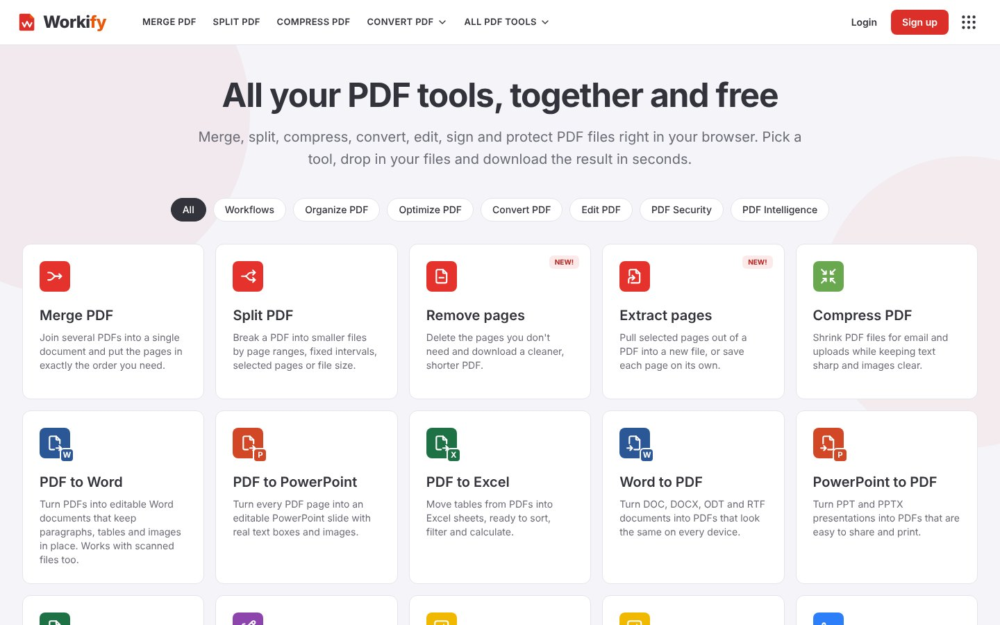

</div>

---

## What is Workify?

Workify is a free, open web app with 30+ PDF tools under one roof. You drop in a file, pick what you want done, and download the result in seconds. Everything from "join these three PDFs" to "get a contract signed by five people" lives in the same clean interface, in 11 languages.

## Why does it exist?

Working with PDFs is a daily chore for students, freelancers, offices and small businesses, and the usual options are bad:

- Most online tools do **one** thing, so you jump between five different sites.
- Free tiers come with **watermarks, page limits, daily caps and aggressive upsells**.
- Many ask you to **upload private documents** to sites you know nothing about.
- Desktop software is **expensive and heavy** for a task that takes a minute.

Workify puts it all in one place, keeps it free, and treats your files with care: uploads are **deleted automatically after one hour**.

## What problems does it solve?

| Problem | How Workify solves it |
| --- | --- |
| "I have 6 PDFs and need one" | **Merge PDF**: drag, reorder, download |
| "The file is too big to email" | **Compress PDF**: smaller size, readable text |
| "I only need pages 3 to 7" | **Split / Extract / Remove pages** |
| "I need it in Word or Excel" | **PDF to Word / PowerPoint / Excel** (and back) |
| "This is a scan, I can't search or copy it" | **OCR** in 34 languages |
| "I must fix a typo or add a stamp" | **Edit PDF**, **Watermark**, **Page numbers** |
| "I need a signature, but printing is a pain" | **Sign PDF** and **signature requests** for up to 20 signers, with a sealed audit trail |
| "I must hide sensitive details" | **Redact PDF**: removes the content for real, not just a black box |
| "I do the same 4 steps every week" | **Workflows**: chain tools once, reuse forever |
| "I'm on my phone" | Installable **PWA**, fully responsive |

## How much time does it save?

Rough, honest estimates for a typical task (your numbers will vary with file size and habits):

| Task | The usual way | With Workify |
| --- | --- | --- |
| Merge several PDFs | 5 to 10 min (find a site, upload one by one, fight limits) | **~20 sec** |
| Shrink a PDF for email | 10 to 15 min of trial and error | **~15 sec** |
| Get a document signed | Print, sign, scan, send: **20 to 30 min**, or days of back and forth | **~2 min** to send, signers sign online |
| Convert a PDF to Word | 10+ min of retyping or fixing layout | **~30 sec** |
| Repeat a multi-step routine | Every time, by hand | **One click** with a saved workflow |

For someone who handles a handful of PDFs a day, that adds up to **roughly 30 to 60 minutes saved every day**, and it stops the hidden cost of tool-hopping and paywalls.

## Screenshots

### Tools

<table>
<tr>
<td width="50%"><b>All tools, one page</b><br>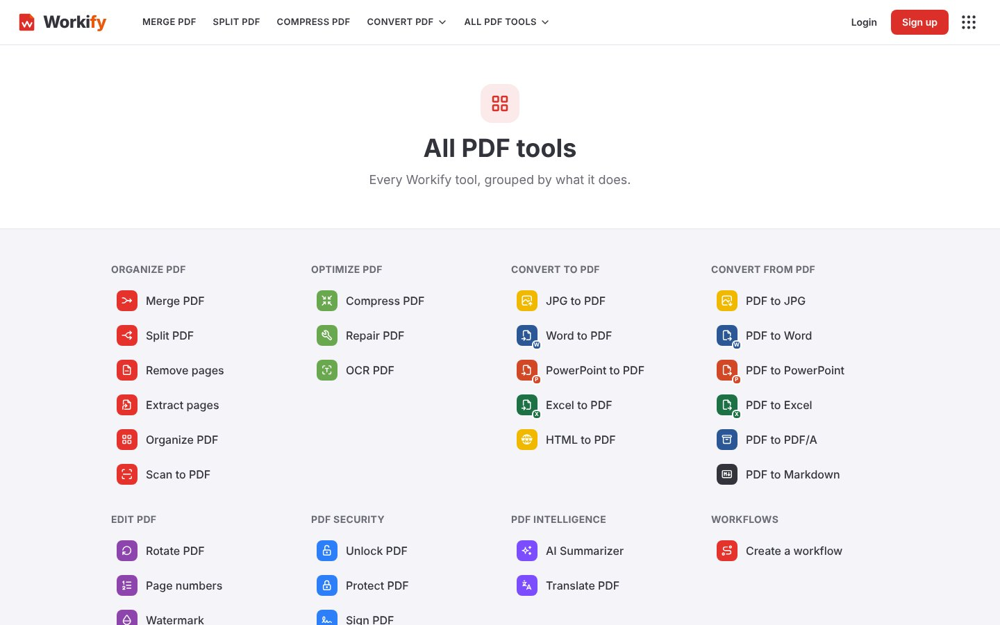</td>
<td width="50%"><b>Merge PDF</b><br>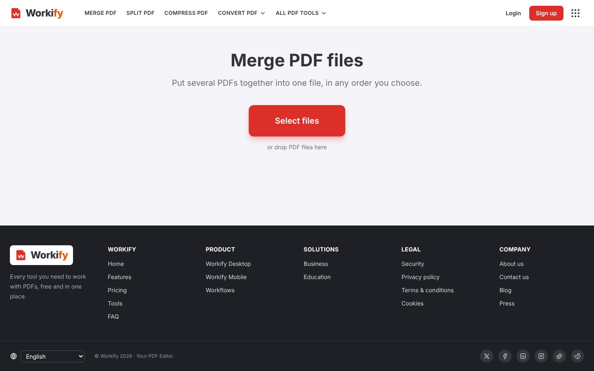</td>
</tr>
<tr>
<td><b>Edit PDF</b>: text, images, shapes, drawing<br>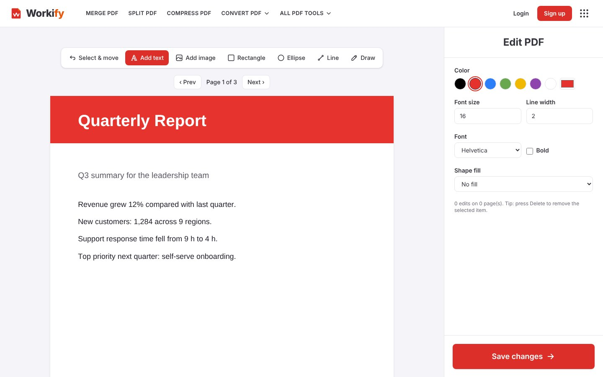</td>
<td><b>Organize PDF</b>: reorder, rotate, delete pages<br>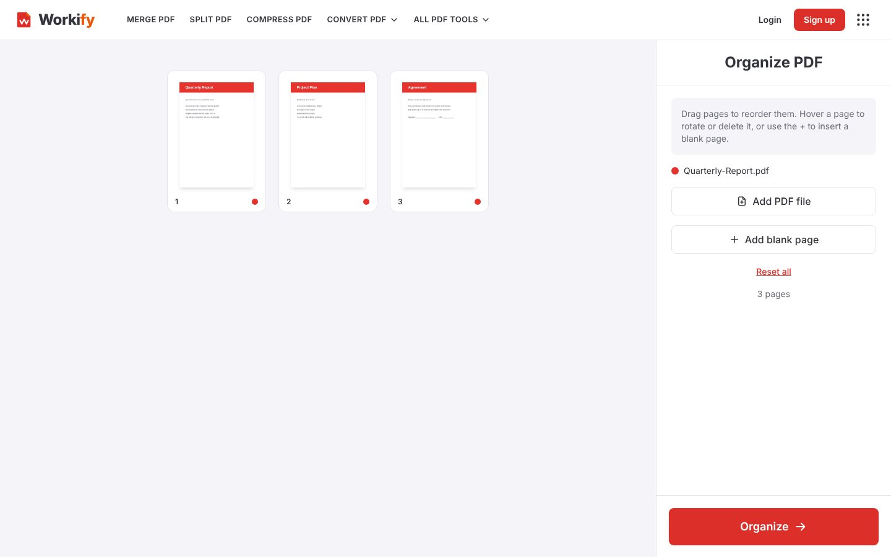</td>
</tr>
<tr>
<td><b>Compress PDF</b><br>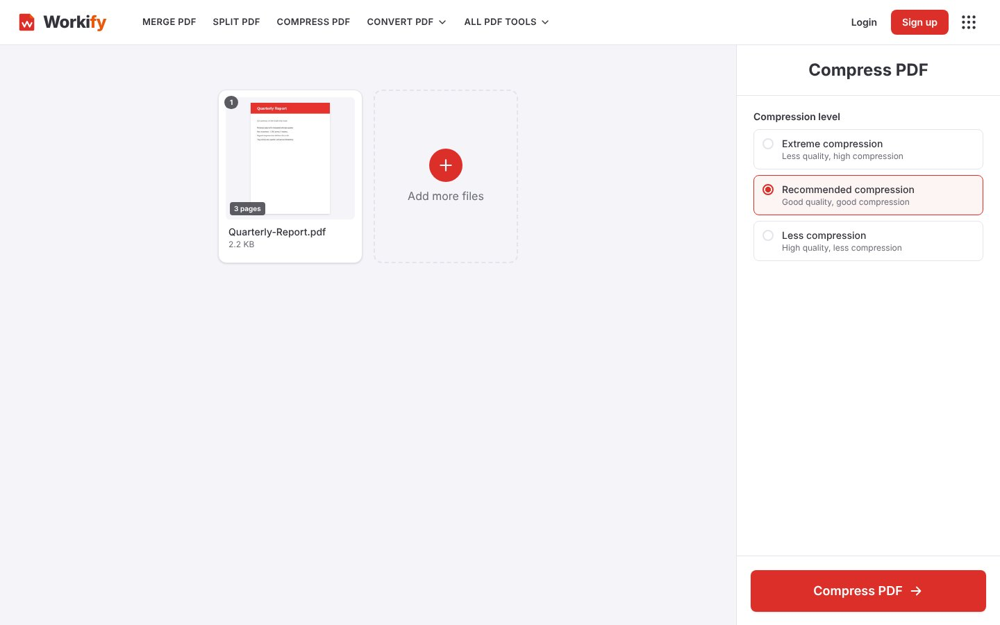</td>
<td><b>Sign PDF</b><br>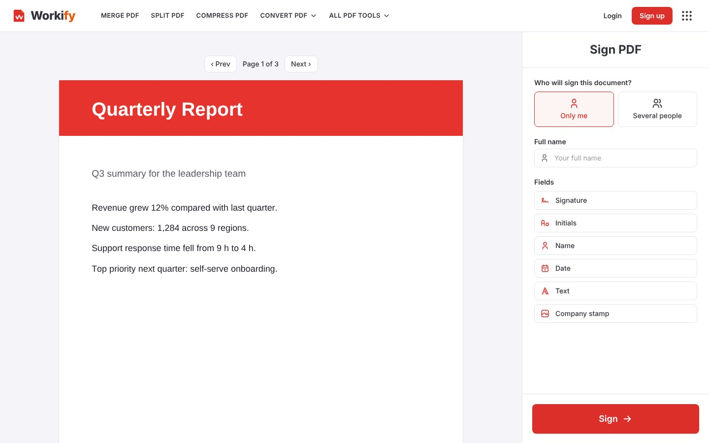</td>
</tr>
<tr>
<td><b>Redact PDF</b><br>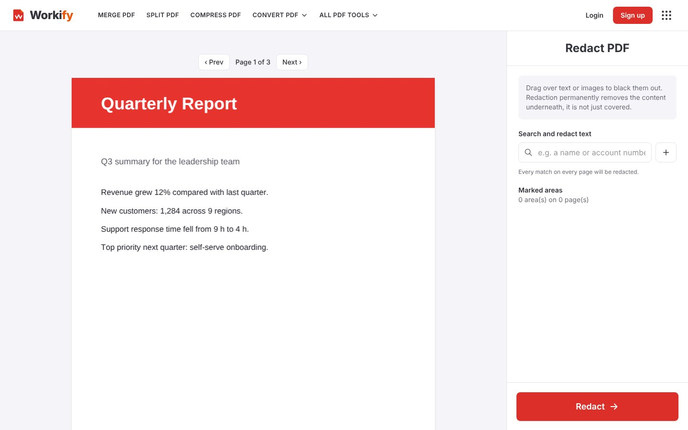</td>
<td><b>Features</b><br>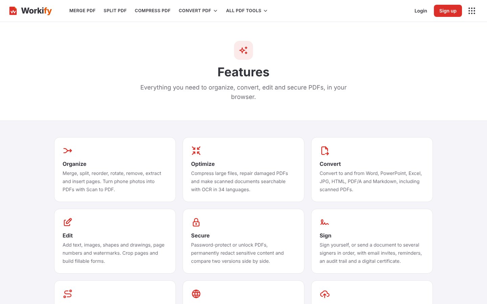</td>
</tr>
</table>

### Accounts, pricing, support

<table>
<tr>
<td width="50%"><b>Sign up</b>: icons on every field, show/hide password<br>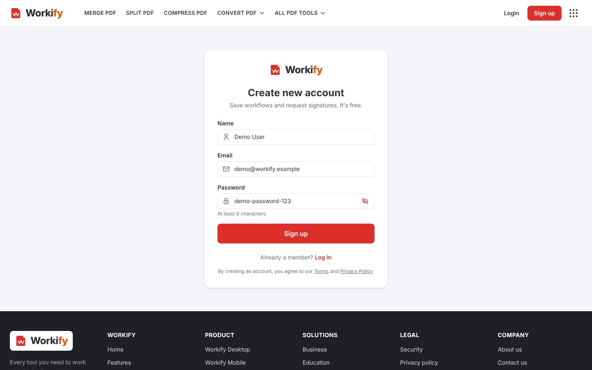</td>
<td width="50%"><b>Pricing</b><br>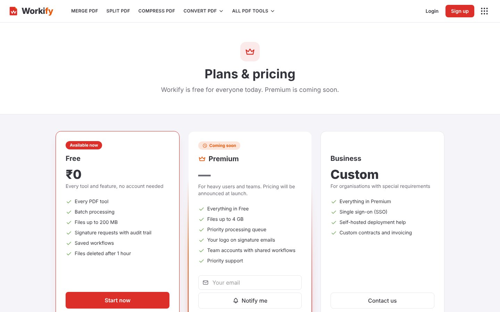</td>
</tr>
<tr>
<td><b>Contact</b><br>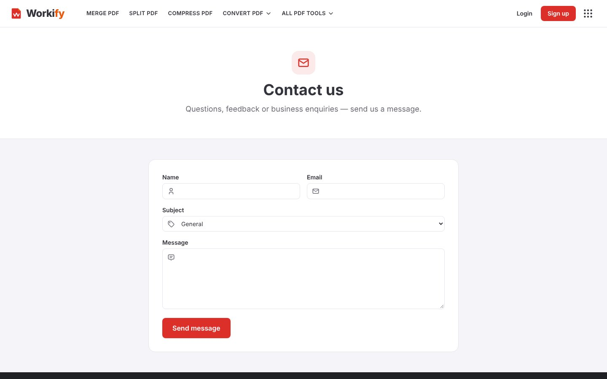</td>
<td><b>Admin panel</b>: usage, users, emails, backups<br>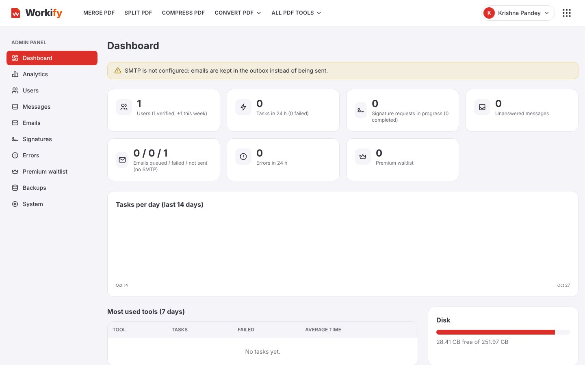</td>
</tr>
</table>

### Multi-language and mobile

<table>
<tr>
<td width="50%"><b>Hindi (11 languages, incl. RTL Arabic)</b><br>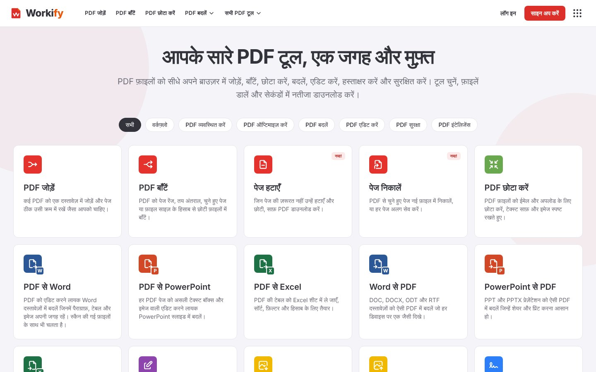</td>
<td width="25%"><b>Mobile</b><br>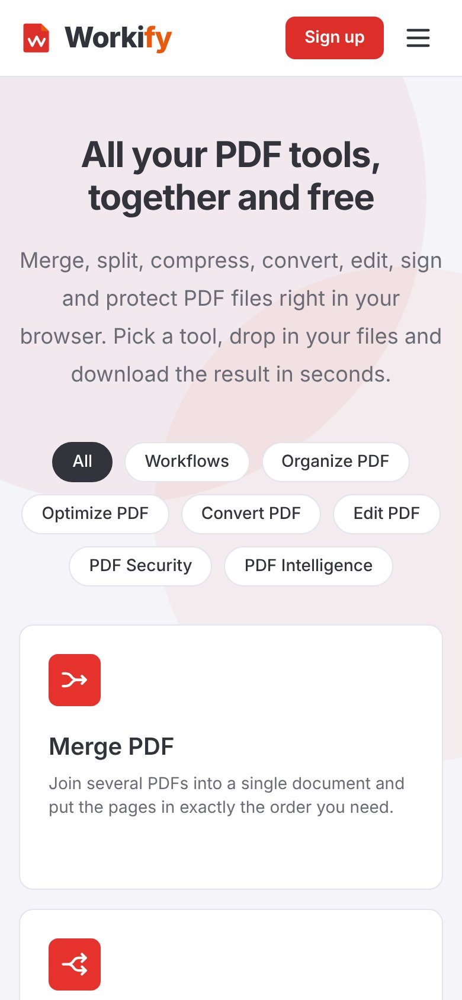</td>
<td width="25%"><b>Mobile tools</b><br>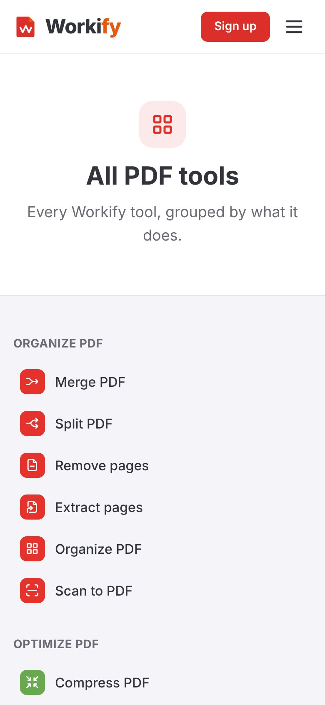</td>
</tr>
</table>

## Highlights

- **30+ tools**: merge, split, remove/extract pages, compress, convert (Word, PowerPoint, Excel, JPG, HTML, PDF/A, Markdown), edit, sign, watermark, redact, compare, OCR, forms, scan-to-PDF
- **Big files and batches**: up to 200 MB per file
- **E-signatures**: request signatures from up to 20 people, with PKCS#7 sealing and an audit trail
- **Workflows**: save multi-step routines and run them again
- **Accounts and admin panel** for usage, users, messages, emails and backups
- **11 languages**, right-to-left layouts included
- **Google Drive and Dropbox** import
- **Installable PWA**, works on phone and desktop
- **Privacy first**: files are removed after 1 hour, rate limiting, scrypt-hashed passwords, strict CSP, SSRF-safe HTML to PDF, daily backups

> Coming soon: AI PDF Summarizer, Translate PDF and a Premium plan.

## Built with

Next.js 16 · React · TypeScript · Tailwind CSS v4 · SQLite · Python, Ghostscript, qpdf, LibreOffice, Tesseract and Chromium for the heavy lifting · Docker and Caddy (automatic HTTPS)

## Run it yourself

```bash
cp .env.example .env     # fill in the values
npm install
npm run dev              # http://localhost:3000
```

Production setup, environment variables and the cloud checklist are in:

- [DEPLOY.md](DEPLOY.md): deploying with Docker and Caddy
- [CLOUD_SETUP.md](CLOUD_SETUP.md): Google Drive, Dropbox and other integrations
- [.env.example](.env.example): every setting, explained

---

<div align="center">

**Made with ❤️ by Krishna Pandey**

</div>
